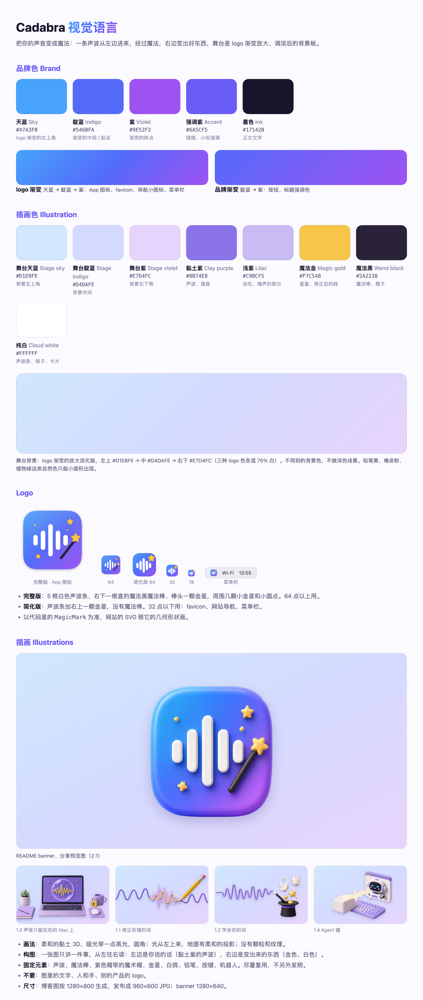

# Visual language

How Cadabra looks, so every picture, icon and page reads as one family. The idea in one line: **your
voice, made into magic**. A sound wave goes in, something delightful comes out, on a pale stage that is the logo's own gradient, made big and soft.

The same as a page: [visual-language.html](https://phg1024.github.io/Cadabra/visual-language.html).

## Colors

### Brand

| Name | Hex | Used for |
|---|---|---|
| Sky | `#47A3FB` | Top-left corner of the mark's tile |
| Indigo | `#546BFA` | Start of the brand gradient; middle of the mark's tile |
| Violet | `#9E52F2` | End of the brand gradient |
| Mark gradient | `#47A3FB → #546BFA → #9E52F2`, top-left to bottom-right | The app icon tile, the favicon, the site's logo glyph |
| Brand gradient | `#546BFA → #9E52F2`, top-left to bottom-right | Primary buttons, the headline accent, the recording bar |
| Accent | `#6A5CF5` | Links, focus rings, small UI accents on light backgrounds |
| Ink | `#17142B` | Text on light backgrounds |

### Illustration

| Name | Hex | Used for |
|---|---|---|
| Stage sky | `#D1E8FE` | Background, top-left corner of every illustration |
| Stage indigo | `#D4DAFE` | Background, the middle |
| Stage violet | `#E7D4FC` | Background, bottom-right corner |
| Clay purple | `#8B74E8` | The sound wave, and props that belong to Cadabra (keys, keyboards, windows) |
| Lilac | `#C9BCF5` | Secondary or faded parts: a noisy, misheard wave; shadows of purple things |
| Magic gold | `#F7C548` (edge `#E09A1F`) | Stars, sparkles, the corrected wave, the star on the wand |
| Wand black | `#2A2238` | The wand, the top hat, other dark objects |
| Cloud white | `#FFFFFF` | The bars in the icon, doves, cards, the robot's shell |

The stage is the mark's gradient made big and pale: the same three colors, each mixed with three
parts white, running diagonally from the top-left to the bottom-right.

A little of a natural color is fine where an object needs it (a yellow pencil, a pink eraser, a green
plant), never as a large area. No other background colors, no dark scenes.

### On the site

The site's CSS variables follow the table: `--brand-1` indigo, `--brand-2` violet, `--brand` accent,
`--gold` `#E7A92A` (gold a little darker, so it reads as text on white). Dark mode keeps the same hues,
lighter: accent `#9B8CFF`, gold `#F5C451`.

## The mark

Five white rounded sound bars (short, medium, tall, medium, short), a little left of center; a straight
**Wand black** wand from the lower right with a **Magic gold** star on its tip; a few gold stars and
dots around. On the **mark gradient** tile.

- **Full mark**: bars, wand, stars. The app icon, and anywhere 64 points or bigger.
- **Small mark**: bars and one gold star at the top right, no wand. 32 points and smaller: the favicon,
  the site's nav, the menu bar window.

The source of truth is code: `MagicMark` in `Sources/Cadabra/Components.swift` (`AppIconArt` renders
the app icon, `AppGlyph` the in-app mark). The site's SVGs copy its geometry.

## Illustrations

Blog thumbnails, the README banner, anything drawn rather than a screenshot.

- **Material**: soft 3D clay, matte with a gentle highlight, rounded edges. Nothing photographic,
  nothing glossy-plastic, no textures and no grain.
- **Light**: soft studio light from the upper left; soft contact shadows on the floor.
- **Stage**: the pale diagonal gradient above, smooth, sky blue at the top-left to violet at the bottom-right.
- **Story**: one idea per picture, read left to right. What you say comes in on the left (a **Clay
  purple** wave); what Cadabra makes of it comes out on the right (gold, white).
- **Vocabulary**: the wave (a slim round clay tube, even above and below its center line, uneven
  heights like speech), the wand, the top hat with a violet band, gold stars, white doves, the pencil,
  the key, the robot. Reuse them instead of inventing new ones.
- **Never**: text or letters in the picture (models garble them), people or hands, logos of other
  products.

### Sizes

| Asset | Generated at | Published as |
|---|---|---|
| Blog thumbnail | 1280×800 (16:10) | `docs/images/blog/<name>.jpg`, 960×600, JPEG quality 88, 4:4:4 |
| README banner, social preview | 1280×640 (2:1) | `docs/images/banner.jpg`, JPEG quality 90, 4:4:4 |
| App icon | Rendered from code | `build.sh` makes the `.icns` |
| Screenshots | The real app, light appearance | PNG in `docs/images/`, `-en` and `-zh` versions |

### Prompt

The thumbnails and the banner were made with a local image model (Qwen-Image). Start every prompt with
the style, then the scene:

> Cute 3D clay render, transparent background. Soft studio light from the upper left, soft contact shadows.
> Colors: clay purple #8B74E8 for the sound wave and props, lilac #C9BCF5 for faded parts, white, wand
> black #2A2238 for dark objects, magic gold #F7C548 for stars and sparkles. No text, no letters, no
> people, no hands.
>
> Scene: …

**The model can't hit exact colors** (it ignores hex codes and paints its own idea of "sky blue"), so the
stage is never left to it. Ask for the objects only, with `--background transparent`, and put them on
the stage with `tools/stage.py cut.png out.png`: it draws the exact gradient, adds a soft violet shadow
under the objects, and dithers the gradient so it doesn't show bands. Save JPEGs with
`subsampling=0` (4:4:4) for the same reason.

To change an existing picture, pass it as the reference and say what to keep ("keep the composition and
every object") before what to change. Editing the same picture over and over adds grain: after two or
three edits, generate it fresh from the full prompt instead.
